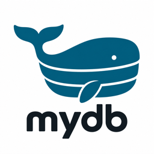

<div align="center">



# MyDB

**A high-performance MySQL-compatible database for HTAP and AI agents**

Mixed transactional and analytical workloads, with native AI retrieval.

[English](README.md) · [简体中文](readme_cn.md)

[Download](https://github.com/yzsind/mydb/releases/tag/v1.0.1) · [Why MyDB](docs/why-mydb.md) · [Performance evaluation](#performance-evaluation) · [Testing](#testing) · [Quick Start](#quick-start) · [Built for AI Agents](#built-for-ai-agents) · [Documentation](docs/README.md) · [MySQL Compatibility](docs/mysql80-compatibility.md)

</div>

---

MyDB is a general-purpose database built in Rust for **HTAP (hybrid
transactional/analytical processing), AI agents, and MySQL compatibility**.
It is designed for mixed workloads that combine transactional reads and writes
with analytical queries over the same business data. Native full-text and
vector retrieval and external model calls extend these workflows through
familiar SQL.

Applications can reuse MySQL clients and drivers, while native REST and MCP
interfaces give services and agents direct access to the same engine. Automatic
Zone Maps, online schema changes, and directly queryable backups reduce the
work needed to tune access, evolve data structures, and inspect earlier data.

MyDB 1.0.1 is a public-preview release intended for feature validation and controlled-environment evaluation.

| Core advantage | What it gives you |
| --- | --- |
| **Built for AI agents** | Native vectors, hybrid retrieval, SQL model calls, and REST/MCP access connect agents with business data. |
| **High-performance HTAP** | Transactional reads and writes alongside analytical queries on one dataset, with parallel execution, vectorization, and automatic Zone Maps. |
| **MySQL compatible** | Reuse MySQL clients, JDBC drivers, common SQL, and ROW/FULL binlog integration. |

Read [Why MyDB](docs/why-mydb.md) for the application benefits, design choices,
and published evidence behind these advantages. RRF is a technical preview;
the linked references describe each capability's supported scope.

## Performance evaluation

**Over 1 million QPS on 16 CPU cores** — sysbench, November 16, 2026:

| Workload | MyDB QPS | P95 latency |
| --- | ---: | ---: |
| `oltp_point_select` | **1,327,407.37** | **0.55 ms** |

The November 16, 2026 MyDB snapshot ran on a 16-core CPU VM, with 100M rows
across 10 tables, 300 client threads on a separate host over the private network, and one
300-second run using sysbench's `special` access distribution. No errors or
reconnects were recorded. See the [full benchmark report](docs/sysbench-100m-300clients-2026-11-16.md)
for configuration, methodology, and complete results.

**MyDB vs. MySQL 8.0**, measured November 17, 2026:

| Workload | MyDB | MySQL | Advantage |
| --- | --- | --- | --- |
| Point queries · 100M rows, 20 clients | 295,724 queries/s | 184,108 queries/s | **1.61x throughput** |
| Read-only transactions · 100M rows, 20 clients | 13,522 transactions/s | 7,477 transactions/s | **1.81x throughput** |
| TPC-H-derived analytics · SF=10, 22 query medians summed | 50.636 s | 1,205.299 s | **23.80x speedup** |
| TPC-DS-derived analytics · SF=10, 84/99 matching on MyDB and MySQL | 92.427 s | 4,468.101 s | **48.34x speedup on that subset** |
| Bulk import · TPC-H SF=10, `LOAD DATA LOCAL INFILE` | 37.281 s | 374.490 s | **10.04x speedup** |

Same 16-vCPU host, 10 GiB database memory limits, and durable commits.
TPC-DS reports only matching MyDB/MySQL files; its subset differs from the
historical three-engine subset. TPC-derived results are unaudited. See the
[detailed comparison](docs/performance-comparison.md) for results, test
conditions, result differences, and limitations.

**Cohere 1M HNSW**, November 14, 2026, 768-dimensional FLOAT32 cosine top-100:

| Measurement | MyDB | PostgreSQL 18.6 + pgvector 0.8.7 | Advantage |
| --- | ---: | ---: | ---: |
| Search, 1 client | 670 queries/s | 179 queries/s | **3.7x throughput** |
| Search, 16 clients | 5,200 queries/s | 1,954 queries/s | **2.7x throughput** |
| Search p99 latency, 16 clients | 5.6 ms | 14.7 ms | **2.6x lower latency** |
| Recall@100 | 94.8% | 94.4% | Comparable (+0.4 pp) |
| HNSW build | 53 s | 118 s | **2.2x speedup** |

The reported search throughput ratio is 2.7x at 16 clients. Both engines used
the same 16-vCPU host,and durable commits. Sources, exact settings, and
reporting limits are documented in the
[November 14 Cohere 1M result record](docs/vector-cohere-1m-hnsw-benchmark-2026-11-14.md).

## Testing

**Over 12,000 automated regression tests and one million fuzz input executions.**
The main and Safety CI runs below are from November 17, 2026, at commit
[`1316cbf4`](https://github.com/yzsind/mydb/commit/1316cbf40cad563a3c3da0c86cfa3233e820cebf).

| Test area | Verified scope and results | Evidence |
| --- | --- | --- |
| Automated regressions | **12,077 passed** across three test partitions. | [CI](https://github.com/yzsind/mydb/actions/runs/44028187611) |
| SQL functions | **450 function names**, including aliases, have associated tests; 430 names have **1,294 fixture cases**, with dedicated integration tests for the other 20. | [CI](https://github.com/yzsind/mydb/actions/runs/44028187611) |
| Fuzz testing with AddressSanitizer | **1,065,432 input executions; 14/14 selected targets passed**, out of 15 declared targets. Covers protocol decoding, storage, SQL parsing and expression execution. | [Safety CI and artifacts](https://github.com/yzsind/mydb/actions/runs/44028187290) |
| Concurrency and fault recovery | **4 Jepsen workloads, 8 crash/COMMIT-disconnect recovery cases and 16 I/O fault combinations passed**, alongside native replication and semi-sync checks. | [Safety CI](https://github.com/yzsind/mydb/actions/runs/44028187290) |

Fault tests check that acknowledged commits survive, unfinished transactions
leave no partial writes, and recovery preserves consistent data. They use local
processes and injected network or I/O faults. See the [Jepsen](tests/jepsen/README.md)
and [fuzz](tests/fuzz/README.md) guides for scope and reproduction.

Counts are a snapshot, not line or branch coverage percentages. Function cases
are included in the regression suite; fuzz executions are not unique test cases.
This short fuzz run excluded `sql_execution_differential`, which failed in a
separate [November 17 scheduled run in the predecessor repository](https://github.com/yzsind/mydb-archive/actions/runs/43998686452).

## Quick Start

Download prebuilt packages for macOS ARM64, Linux x86_64, and Windows x64 from the
[1.0.1 release page](https://github.com/yzsind/mydb/releases/tag/v1.0.1), which also
includes SHA256 checksums and platform validation details.

### Run a downloaded binary

Download the package for your platform, extract it, and open a terminal in the
directory containing the executable. On macOS or Linux, start it with:

```bash
chmod +x ./mydb
./mydb --data-dir ./data
```

On Windows, run the equivalent command in PowerShell:

```powershell
.\mydb.exe --data-dir ./data
```

The server listens on all IPv4 interfaces (`0.0.0.0:8738`) and stores data in `./data`. No Rust
toolchain or config file is needed. With a MySQL 8.0 client installed, connect
from another terminal:

```bash
mysql -h127.0.0.1 -P8738 -uroot -proot test
```

A fresh data directory includes the `test` database and the local `root` account
with password `root`. Run `SELECT 1;` to check the connection. Enter `quit` to
exit the client, then press **Ctrl+C** in the server terminal to stop it. Restart
with the same data directory to reopen your data.

### Native Rust client

Build the independent client from a source checkout:

```bash
cargo build --release --locked --manifest-path clients/mydb-cli/Cargo.toml
./clients/mydb-cli/target/release/mydb-cli -h127.0.0.1 -P8738 -uroot -p test
```

The client provides interactive editing and completion, SQL scripts, table/TSV/
vertical output, TLS, and query cancellation. See the [client manual](docs/mydb-cli.md).

### Build and connect

Install Rust 1.95 or newer, a native C toolchain, Perl, and a MySQL 8.0 client;
the shell commands below target macOS and Linux.

```bash
git clone https://github.com/yzsind/mydb.git
cd mydb
cargo build --release --locked --bin mydb

MYDB_DATA_DIR=/tmp/mydb/data \
  ./target/release/mydb --port 8738
```

When the server is ready, connect from another terminal:

```bash
mysql -h127.0.0.1 -P8738 -uroot -proot test
```

A fresh data directory creates `root@localhost` with password `root` and a `test`
database. This account accepts only loopback connections. `MYDB_ROOT_PASSWORD`
sets the initial password on first start; it does not change existing accounts.
The default protocol port is `8738`; override it with `--port`.

Try a write, an aggregate, and a window function:

```sql
CREATE TABLE orders (
    id BIGINT PRIMARY KEY,
    region VARCHAR(32),
    amount DECIMAL(12, 2)
);

INSERT INTO orders VALUES
    (1, 'east', 120.00),
    (2, 'south', 80.00),
    (3, 'east', 180.00);

SELECT region,
       SUM(amount) AS revenue,
       DENSE_RANK() OVER (ORDER BY SUM(amount) DESC) AS revenue_rank
FROM orders
GROUP BY region
ORDER BY revenue_rank, region;
```

### Docker

Pull the prebuilt image from Docker Hub and run a container (stop any local
instance using port `8738` first):

```bash
docker pull ninedata/mydb:latest
docker volume create mydb-data

docker run -d --name mydb \
  -p 127.0.0.1:8738:8738 \
  -v mydb-data:/var/lib/mydb \
  -e MYDB_ROOT_PASSWORD='change-me' \
  ninedata/mydb:latest

docker exec -it mydb mysql -h127.0.0.1 -P8738 -uroot -p --ssl
```

Enter `change-me` for the password on a fresh volume. Stop with `docker stop
mydb` and restart with `docker start mydb`; the named volume retains the data.
Bridge/NAT connections through the published port do not match `root@localhost` —
create a dedicated account in that SQL session for host connections. The image
enables TLS, `fast-alloc`, and the MySQL replication receiver by default.
See the [Docker deployment guide](docs/docker.md) for certificates, mounted
configuration, cross-architecture builds, and connecting from the host.

### Platforms and distribution

Supported operating systems: macOS (arm64 and Intel) and Linux (x86_64 and
aarch64), plus Windows 11 for foreground operation on local NTFS. See
[hardware and OS requirements](docs/hardware-and-os-requirements.md) for
verification details, Windows limitations, and distribution scope.

## Architecture


## REST SQL

An optional [REST SQL API](docs/rest-api.md) accepts parameterized SQL over
HTTPS, supports persistent transactions and NDJSON streaming, and shares MySQL
accounts and permissions. Accounts manage their API keys through SQL over a
TLS-authenticated MySQL connection.

The optional [MCP Server](docs/mcp.md) gives agents native tools to discover
databases and tables, inspect schemas and query plans, execute parameterized
SQL, and manage sessions. REST and MCP share an HTTP listener and support
batches, transactions through persistent sessions, timeouts, and cancellation.
API keys inherit their owning account's current permissions and quotas, so
applications can use these interfaces without building a separate SQL gateway
or MCP adapter. Both interfaces are enabled explicitly; HTTPS is the default.

## Built for AI Agents

An agent's data needs change with every task: add a column, build an index, write embeddings, then join retrieval results back to business data. MyDB combines transactional data, retrieval, and SQL access to external models for retrieval-augmented generation (RAG), knowledge bases, and persistent agent memory.

### Model calls in SQL: generate text and embeddings

- **Text generation**: `AI_GENERATE` accepts a prompt or text message history for summarization, classification, extraction, and answer generation over selected data.
- **Native embeddings**: `AI_EMBED` returns a FLOAT32 `VECTOR` with validated dimensions. `AI_EMBED_DETAIL` also accepts explicit batches of texts.
- **Local and remote services**: configure SQL connection and model objects for Ollama, OpenAI Responses, Chat Completions-compatible services, and Embeddings-compatible services. Model weights and inference run outside MyDB.
- **Structured results**: generation can request JSON Schema output when the configured deployment supports it; MyDB parses and validates the result locally. `_DETAIL` functions expose model revision, provider-reported token usage, timings, and explicit call errors.

Ordinary filtering, joins, sorting, and `LIMIT` run before calls in the final
SELECT projection, so applications can select the rows to enrich before
contacting a model. Calls also support a single `SET @variable = AI_...`
assignment. See [LLM and embedding calls](docs/ai.md) and the
[AI function reference](docs/function/ai/README.md) for setup and supported SQL contexts.

### Smart indexing: fewer full scans without manual indexes

MyDB enables automatic **Zone Maps** on persistent user tables by default.
Per-block summaries let eligible scans skip blocks that cannot match a
predicate, reducing work without requiring a hand-built B-tree index for every
filtering pattern. Serial, parallel, and vectorized scans retain final
predicate checks; missing or untrusted summaries fall back to a regular scan.
The benefit depends on data layout and selectivity. See the
[feature overview](docs/feature-overview.md) for the mechanism and fallbacks.

### Online DDL: schemas that evolve with the task

MyDB's heap tables keep row storage separate from indexes, so adding a primary
key does not reorganize the heap into a clustered table. Schema versions,
online builds, and concurrent change capture reduce interruption during
supported schema changes:

- **Online index and primary key creation**: regular and unique B-tree indexes and newly added primary keys allow concurrent DML while being built.
- **Read-compatible column changes**: adding columns without storage rewrites, compatible type modifications, and some metadata-only changes keep ordinary queries running.
- **Online column type changes**: supported physical rewrites use shadow storage and incremental catch-up, allowing concurrent reads and writes during the build.
- **Constraints and charset settings**: online foreign keys, CHECK constraints, and default charset/collation metadata changes.

Preparation and publication still require barriers, and some physical rewrites
and partition operations wait for readers. Supported algorithms and lock modes
depend on the operation, types, and indexes. See
[ALTER TABLE](docs/statement/ddl/alter-table.md),
[online column type changes](docs/online-column-type-change.md), and the
[DDL compatibility boundaries](docs/mysql80-compatibility.md#table-ddl).

### Native vectors: from storage to large-scale similarity search

- **Native `VECTOR(n, datatype)` type**: FLOAT32 (default), FLOAT16, BFLOAT16, INT8, and BINARY retain their native payloads. Numeric vectors support L2, cosine, and dot-product distance; BINARY supports Hamming and Jaccard. Dimension limits depend on the datatype, from 16,383 for FLOAT32 to 524,256 bits for BINARY.
- **HNSW and IVF indexes**: both support memory and paged storage. Paged index pages participate in the buffer pool and WAL, allowing index payloads to exceed memory capacity; exact KNN scans are also available.
- **Explicit quantization**: `WITH (quantization=sq8|sq4|pq|bq)` compresses numeric index payloads, with final re-ranking against visible heap values. The default is `none`; search breadth and re-ranking budgets determine the recall, memory, and latency tradeoff.
- **Unified SQL**: the optimizer recognizes `ORDER BY distance LIMIT k` and supports parameterized queries; vector writes participate in transaction commit and rollback.

Combined with JSONB, full-text, and structured queries, this supports semantic search, knowledge retrieval, and agent memory. Start with the [vector data and similarity search guide](docs/vector-search.md), then see [vector datatypes and indexes](docs/vector-indexes.md) for options, training, limits, and recovery, and the [vector function reference](docs/function/vector/README.md). The current implementation is HNSW / IVF; disk residency does not imply a complete DiskANN implementation.

### Hybrid retrieval: keyword relevance and semantic similarity

MyDB combines [BM25 full-text search](docs/fulltext-search.md), boolean search,
and an `ngram` parser with native vector retrieval. The SQL `RRF` expression
fuses two to eight independently ranked lists using reciprocal rank fusion,
with configurable weights and optional per-branch score explanations. Its
results can feed ordinary joins, CTEs, aggregation, and window functions.

Applications can apply tenant, authorization, deletion, and model-version
filters inside each retrieval branch before its candidate limit, then join the
fused IDs back to source text and business records. All branches share the
statement's transaction view. The [hybrid search guide](docs/hybrid-search.md)
includes Python retrieval examples, optional external reranking, and a
[LangChain adapter](examples/python/hybrid_langchain.py). RRF is a technical
preview; retrieval quality depends on the data, models, and candidate windows.

### Governed model access and observable calls

- **Model privileges**: `AI_ADMIN` manages AI objects; `AI_USE` can be granted per model independently of table read privileges.
- **Encrypted credentials**: API keys are stored as encrypted Secrets. SQL metadata views do not expose decrypted keys; Secret DDL requires TLS.
- **Bounded execution**: concurrency, queue, memory, request-rate, and output budgets govern model calls. Deadlines and `KILL` cancel local waits, and optional node policies restrict outbound destinations.
- **Visibility**: `SHOW AI MODELS`, `information_schema.MYDB_AI_RUNTIME_STATUS`, and `_DETAIL` results expose configuration and execution information. `EXPLAIN` shows the external stage without calling a provider; `EXPLAIN ANALYZE` executes it.

Model calls require autocommit outside explicit transactions and are rejected
in DML, predicates, and persistent schema expressions. Save generated values
with a subsequent ordinary write; rollback or cancellation cannot undo work
already received by a provider. See the [execution boundaries](docs/ai.md#execution-boundaries)
and [administration guide](docs/ai.md#administration-and-visibility).

### Try vector retrieval and RETURNING

Still in the `test` database, create a small collection on a `VECTOR` column
declared `NOT NULL`; `RETURNING` gives the inserted IDs directly to the caller:

```sql
CREATE TABLE agent_notes (
    id BIGINT PRIMARY KEY,
    content VARCHAR(128),
    embedding VECTOR(3) NOT NULL
);

INSERT INTO agent_notes VALUES
    (1, 'order summary', STRING_TO_VECTOR('[1,0,0]')),
    (2, 'shipping details', STRING_TO_VECTOR('[1,1,0]')),
    (3, 'account settings', STRING_TO_VECTOR('[0,0,2]'))
RETURNING id;

CREATE INDEX idx_agent_notes_embedding ON agent_notes (embedding)
USING HNSW WITH (metric=l2);

SELECT id, content,
       L2_DISTANCE(embedding, STRING_TO_VECTOR('[1,0,0]')) AS distance
FROM agent_notes
ORDER BY distance
LIMIT 2;
```

The INSERT returns IDs `1`, `2`, `3`; the query returns the two rows nearest to
`[1,0,0]` by L2 distance. HNSW provides approximate nearest-neighbor search —
recall and performance on larger collections depend on data and parameters. See
[CREATE INDEX](docs/statement/ddl/create-index.md),
[vector functions](docs/function/vector/README.md), and
[INSERT RETURNING](docs/statement/dml/insert.md).

After configuring and authorizing `test.local_chat` and `test.local_embed`
with the [Ollama setup](docs/ai.md#configure-ollama), try model calls through the
same SQL connection:

```sql
SELECT AI_GENERATE('test.local_chat',
                   'Explain how semantic search helps an AI agent.') AS answer;

SET @query_embedding = AI_EMBED('test.local_embed', 'shipping details');
SELECT VECTOR_DIM(@query_embedding) AS embedding_dimensions;
```

Use that query embedding to search a collection populated with the same model
revision and vector dimensions. The three-dimensional vectors in `agent_notes`
above are illustrative values and do not share the configured model's embedding space.

## High-performance HTAP

MyDB is designed for HTAP mixed workloads: transactional point lookups,
inserts, and updates run alongside joins, aggregation, and window queries on
the same data. MVCC and locking provide transaction semantics, while the
optimizer selects execution paths for different query shapes. Parallel
execution, data skipping, and unified memory budgets support the analytical
work within that mixed workload.

| Design | Capability |
| --- | --- |
| **Transactional storage** | Heap tables, B-trees, MVCC, row locks, WAL, undo, and crash recovery, with SAVEPOINT and XA two-phase commit. |
| **Cost-based optimizer** | Chooses access paths, join orders, and join algorithms from statistics and a cost model. |
| **Parallel hash join** | Uses multiple cores for joins, scans, and aggregation on complex analytical SQL. |
| **Vectorized execution and SIMD** | Processes data in batches, cutting per-row dispatch and computation overhead on suitable paths. |
| **Automatic scan reduction** | Combines zone maps, partition pruning, predicate pushdown, projection pruning, and covering indexes. |
| **Unified memory management** | Coordinates the buffer pool, caches, and executor budgets; sort and hash-join operators spill to disk. |

Query capabilities include CTEs, recursive CTEs, subquery decorrelation, set operations, window functions, and `ROLLUP` / `CUBE` / `GROUPING SETS`. See [optimizer and operators](docs/optimizer-and-operators.md), and [MVCC and locking](docs/mvcc-and-locking.md).

## MySQL compatible

**Reuse the connection methods and SQL your application already knows.**

- **Clients and drivers**: MySQL classic protocol is supported, so the MySQL CLI, Connector/J, and other clients work; prepared statements, binary result sets, and read-only server-side cursors are included.
- **Core SQL**: common DDL, DML, transactions, queries, functions, and privilege management are covered. Whether a given application needs no changes should be verified against your actual SQL and transaction semantics.
- **binlog ecosystem**: MyDB can act as a MySQL binlog source or replication receiver, and downstream sync tools built on supported binlog events can ingest from it. Only **ROW/FULL** images are supported; SBR/MIXED and MINIMAL are not.

The full coverage map, transactional differences, and unsupported features are listed in the [MySQL 8.0 compatibility matrix](docs/mysql80-compatibility.md).

## Practical extensions beyond MySQL

| Feature | Use |
| --- | --- |
| **FULL OUTER JOIN** | Compare datasets while retaining unmatched rows from both sides. |
| **CUBE / GROUPING SETS** | Compute several levels of aggregation in one query. |
| **Window GROUPS / EXCLUDE** | Express additional window frame and exclusion rules. |
| **Wider TIMESTAMP range** | Supports dates beyond 2038, up to year 9999. |
| **Sequences** | Standalone sequence objects with `NEXTVAL`, `CURRVAL`, and friends. |
| **DML `RETURNING` with OLD / NEW** | Return modified rows directly, saving follow-up queries; multi-target restrictions apply. |
| **`generate_series()`** | Integer, decimal, and datetime series for time axes, gap filling, and data generation. |
| **TABLESAMPLE** | Explore data with row/page sampling, percentage or exact row counts, and repeatable samples. |
| **B-tree INCLUDE** | Cover query columns without adding them to the search key. |
| **`CREATE OR REPLACE` routines** | Replace procedure and function definitions while preserving routine grants. |
| **SQL ROWID** | Locate heap rows directly; physical addresses can be reused. |

See the [SQL capability map](docs/mysql80-compatibility.md#select-capabilities),
[DML RETURNING](docs/dml-returning.md), [sequences](docs/sequences.md),
[series generation](docs/generate-series.md), and [SQL ROWID](docs/rowid.md).

## Data protection and native replication

MyDB combines recovery with direct SQL inspection, giving operators and agents
more ways to investigate earlier data before restoring an entire instance.

| Capability | What it gives you |
| --- | --- |
| [Recycle bin](docs/recycle-bin.md) | Query and restore retained tables after eligible DROP or TRUNCATE operations, including tables removed by DROP DATABASE. |
| [Time travel](docs/mysql80-compatibility.md#time-travel-queries) | Query and join historical data with `FOR SYSTEM_TIME AS OF` within the retained history window. |
| [Direct backup queries](docs/backup-and-recovery.md) | Open a sealed physical base read-only without copying the whole database or replaying WAL. |
| [Online backup and PITR](docs/backup-and-recovery.md) | Capture a full instance baseline, archive subsequent WAL, verify recovery inputs, and restore by time or LSN. |
| [Native WAL replication](docs/native-replication.md) | Maintain a MyDB standby independently of MySQL binlog, with asynchronous or semi-synchronous replication and controlled role changes. |

The recycle bin defaults to a seven-day retention target, subject to expiration
and disk-pressure reclamation; triggers, foreign keys, row policies, and grants
are not restored with the table. WAL archiving is enabled separately from a full
backup. Native role changes require external fencing of the former primary.

Unified memory accounting, query budgets, cache reclamation, and spill-capable
operators help manage resource use across these workloads. `SHOW MYDB MEMORY`,
`SHOW MYDB MEMORY SESSIONS`, and `SHOW ENGINE MYDB STATUS` expose memory and
engine diagnostics. See [memory configuration](docs/configuration-resources.md)
and [MVCC and locking](docs/mvcc-and-locking.md) for resource and concurrency
behavior.

## Compatibility boundaries

- **MySQL compatibility has explicit scope**: the classic protocol is supported, X Protocol is not; the native storage engine is not file- or plugin-ABI-compatible with InnoDB.
- **Transaction semantics differ**: the default isolation level is `READ COMMITTED`; `REPEATABLE READ` intentionally uses MVCC snapshot isolation without InnoDB gap/next-key locks to avoid range-lock contention, insert blocking, and the associated deadlock patterns. `SERIALIZABLE` range-insert prevention uses table-level shared locks. See [MVCC and locking](docs/mvcc-and-locking.md#snapshot-lifecycle-and-isolation-levels) for the design and semantic boundaries.
- **Replication has prerequisites**: MySQL → MyDB replication is built into every server build and requires ROW/FULL binlog on the source; native physical replication uses controlled, manual role switching with no automatic leader election.
- **Time travel has a window**: table-level `FOR SYSTEM_TIME AS OF` depends on undo retention settings, and the default retention window is `0`; queries across schema DDL boundaries are explicitly rejected.

Unimplemented SQL or protocol capabilities return clear errors rather than failing silently. The detailed scope is defined by the [compatibility matrix](docs/mysql80-compatibility.md), the source, and the tests.

## Documentation

| Entry point | Contents |
| --- | --- |
| [Why MyDB](docs/why-mydb.md) | HTAP mixed workloads, AI capabilities, application benefits, and performance evidence |
| [Documentation index](docs/README.md) | Product, SQL, operations, and implementation docs |
| [Feature overview](docs/feature-overview.md) | Capability map and implementation boundaries |
| [AI model calls](docs/ai.md) / [Hybrid search](docs/hybrid-search.md) | Model setup, embeddings, generation, permissions, and retrieval fusion |
| [SQL statements](docs/statement/README.md) / [Functions](docs/function/README.md) | Syntax, semantics, and usage examples |
| [Configuration guide](docs/configuration.md) / [Config template](mydb.cnf.example) | Startup options, environment variables, and runtime settings |
| [Data directory and recovery](docs/storage-format.md) | File roles, format compatibility, durability, and crash recovery |

Product documentation under `docs/` is written in English. When documentation
and behavior disagree, the source code and tests are authoritative; the
compatibility matrices describe the documented scope.

## Reporting issues

Submit bug reports through [GitHub Issues](https://github.com/yzsind/mydb/issues).
Follow the [issue reporting guide](docs/reporting-issues.md) and include the exact
MyDB version, operating system, relevant logs, and reproducible steps and scripts.

MyDB is licensed under the [Apache License 2.0](LICENSE).
