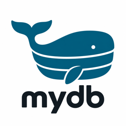
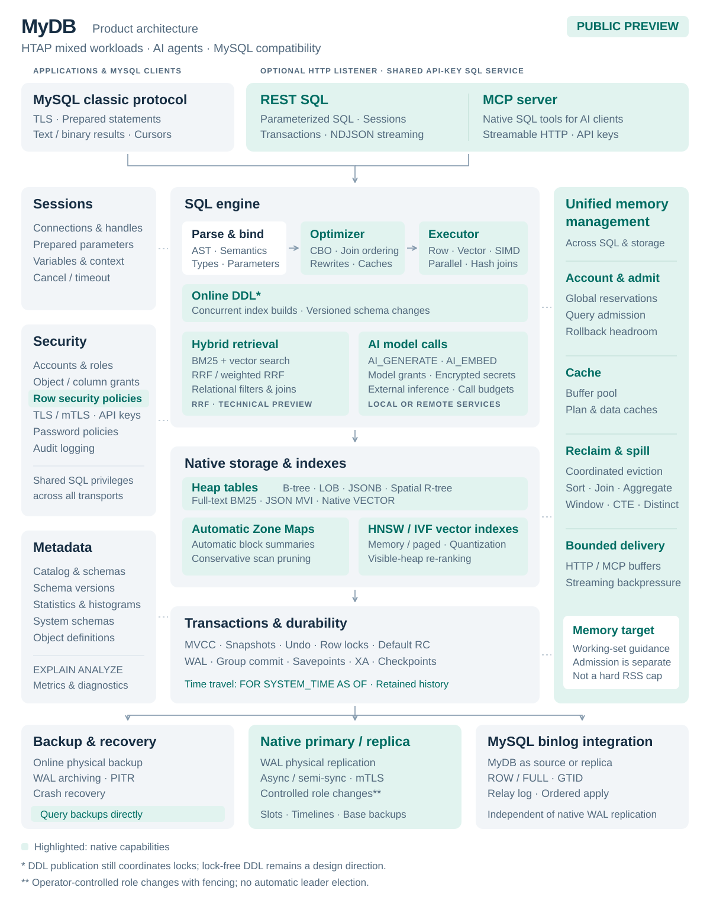

<div align="center">



# MyDB

**面向 HTAP 和 AI 智能体的高性能 MySQL 兼容数据库**

支持事务与分析混合负载，内置 AI 检索能力。

[English](README.md) · [简体中文](readme_cn.md)

[下载](https://github.com/yzsind/mydb/releases/tag/v1.0.3) · [为什么选择 MyDB](docs/why-mydb.md) · [性能评测](#性能评测) · [测试验证](#测试验证) · [快速开始](#快速开始) · [为 AI 智能体而构建](#为-ai-智能体而构建) · [文档](docs/README.md) · [MySQL 兼容性](docs/mysql80-compatibility.md)

</div>

---

MyDB 是使用 Rust 构建的通用数据库，面向 **HTAP（混合事务与分析处理）、AI 智能体和 MySQL 兼容性**。
它为混合负载而设计，可在同一份业务数据上同时执行事务读写与分析查询。
内置的全文检索、向量检索和外部模型调用，让这些工作流可以通过熟悉的 SQL 进一步扩展。

应用可以复用 MySQL 客户端和驱动，原生 REST 和 MCP 接口则让服务与智能体直接访问同一个引擎。
自动 Zone Maps、在线模式变更和可直接查询的备份，减少了访问调优、数据结构演进以及历史数据检查所需的工作。

MyDB 1.0.3 是公开预览版本，用于功能验证和受控环境下的评估。
变更与升级要求见 [1.0.3 Release Notes](docs/release-notes-1.0.3.md)。

| 核心优势 | 带来的能力 |
| --- | --- |
| **为 AI 智能体而构建** | 原生向量、混合检索、SQL 模型调用以及 REST/MCP 访问，将智能体与业务数据连接起来。 |
| **高性能 HTAP** | 在同一数据集上同时执行事务读写和分析查询，支持并行执行、向量化和自动 Zone Maps。 |
| **兼容 MySQL** | 复用 MySQL 客户端、JDBC 驱动、常用 SQL 和 ROW/FULL binlog 集成。 |

请阅读[为什么选择 MyDB](docs/why-mydb.md)，了解这些优势背后的应用收益、设计选择和已发布的验证依据。
RRF 目前处于技术预览阶段；各能力的支持范围见对应参考文档。

## 性能评测

**16 核 CPU 上超过 100 万 QPS**——2026 年 11 月 16 日 sysbench 测试：

| 负载 | MyDB QPS | P95 延迟 |
| --- | ---: | ---: |
| `oltp_point_select` | **1,327,407.37** | **0.55 ms** |

2026 年 11 月 16 日的 MyDB 快照在一台 16 核 CPU 虚拟机上运行，10 张表共 1 亿行数据，
另一台主机通过内网运行 300 个客户端线程，使用 sysbench 的 `special` 访问分布进行了一次 300 秒测试。
测试未记录到错误或重连。配置、方法和完整结果见[完整基准报告](docs/sysbench-100m-300clients-2026-11-16.md)。

**MyDB 与 MySQL 8.0 对比**，测试日期为 2026 年 11 月 17 日：

| 负载 | MyDB | MySQL | 优势 |
| --- | --- | --- | --- |
| 点查询 · 1 亿行，20 个客户端 | 295,724 次查询/秒 | 184,108 次查询/秒 | **吞吐量为 1.61 倍** |
| 只读事务 · 1 亿行，20 个客户端 | 13,522 个事务/秒 | 7,477 个事务/秒 | **吞吐量为 1.81 倍** |
| 基于 TPC-H 的分析 · SF=10，22 条查询的耗时中位数之和 | 50.636 s | 1,205.299 s | **加速 23.80 倍** |
| 基于 TPC-DS 的分析 · SF=10，99 条中有 84 条在 MyDB 和 MySQL 上结果一致 | 92.427 s | 4,468.101 s | **该子集加速 48.34 倍** |
| 批量导入 · TPC-H SF=10，`LOAD DATA LOCAL INFILE` | 37.281 s | 374.490 s | **加速 10.04 倍** |

测试使用相同的 16 vCPU 主机、10 GiB 数据库内存限制和持久化提交。
TPC-DS 仅统计 MyDB/MySQL 结果文件一致的查询；这一子集与历史上三个引擎对比时采用的子集不同。
基于 TPC 的结果未经审计。结果、测试条件、结果差异和限制见[详细对比](docs/performance-comparison.md)。

**Cohere 100 万向量 HNSW**，2026 年 11 月 14 日，768 维 FLOAT32，余弦距离 top-100：

| 指标 | MyDB | PostgreSQL 18.6 + pgvector 0.8.7 | 优势 |
| --- | ---: | ---: | ---: |
| 检索，1 个客户端 | 670 次查询/秒 | 179 次查询/秒 | **吞吐量为 3.7 倍** |
| 检索，16 个客户端 | 5,200 次查询/秒 | 1,954 次查询/秒 | **吞吐量为 2.7 倍** |
| 检索 p99 延迟，16 个客户端 | 5.6 ms | 14.7 ms | **延迟降低至约 1/2.6** |
| Recall@100 | 94.8% | 94.4% | 接近（高 0.4 个百分点） |
| HNSW 构建 | 53 s | 118 s | **加速 2.2 倍** |

所报告的 2.7 倍检索吞吐量比值对应 16 个客户端。两个引擎使用相同的 16 vCPU 主机和持久化提交。
数据来源、精确配置和报告限制见[11 月 14 日 Cohere 100 万向量测试记录](docs/vector-cohere-1m-hnsw-benchmark-2026-11-14.md)。

## 测试验证

**超过 12,000 项自动化回归测试和 100 万次模糊测试输入执行。**
以下主 CI 与 Safety CI 结果来自 2026 年 11 月 17 日的提交
[`1316cbf4`](https://github.com/yzsind/mydb/commit/1316cbf40cad563a3c3da0c86cfa3233e820cebf)。

| 测试领域 | 已验证范围与结果 | 依据 |
| --- | --- | --- |
| 自动化回归 | 三个测试分区共 **12,077 项通过**。 | [CI](https://github.com/yzsind/mydb/actions/runs/44028187611) |
| SQL 函数 | **450 个函数名**（含别名）有关联测试；其中 430 个名称有 **1,294 个 fixture 用例**，其余 20 个有专门的集成测试。 | [CI](https://github.com/yzsind/mydb/actions/runs/44028187611) |
| 配合 AddressSanitizer 的模糊测试 | **1,065,432 次输入执行；选中的 14/14 个目标全部通过**，共声明 15 个目标。覆盖协议解码、存储、SQL 解析和表达式执行。 | [Safety CI 及产物](https://github.com/yzsind/mydb/actions/runs/44028187290) |
| 并发与故障恢复 | **4 项 Jepsen 负载、8 项崩溃/COMMIT 断连恢复用例和 16 种 I/O 故障组合通过**，同时验证了原生复制和半同步复制。 | [Safety CI](https://github.com/yzsind/mydb/actions/runs/44028187290) |

故障测试检查已确认的提交能否保留、未完成事务是否不会留下部分写入，以及恢复后数据是否一致。
这些测试使用本地进程，并注入网络或 I/O 故障。测试范围和复现方法见
[Jepsen](tests/jepsen/README.md) 和[模糊测试](tests/fuzz/README.md)指南。

这些数量是某一时点的快照，不代表行覆盖率或分支覆盖率。函数用例已包含在回归套件中；模糊测试执行次数不等于独立测试用例数。
这次短时模糊测试未包含 `sql_execution_differential`，该目标在
[11 月 17 日前身仓库的另一次定时运行](https://github.com/yzsind/mydb-archive/actions/runs/43998686452)中失败。

## 快速开始

可从 [1.0.3 发布页面](https://github.com/yzsind/mydb/releases/tag/v1.0.3)
下载 macOS ARM64、Linux x86_64 和 Windows x64 的预编译包，页面同时提供 SHA256 校验和与平台验证详情。

### 运行下载的二进制程序

下载适合你所在平台的软件包，解压后，在可执行文件所在目录打开终端。macOS 或 Linux 上使用以下命令启动：

```bash
chmod +x ./mydb
./mydb --data-dir ./data
```

Windows 上在 PowerShell 中运行对应命令：

```powershell
.\mydb.exe --data-dir ./data
```

服务器监听所有 IPv4 接口（`0.0.0.0:8738`），并将数据存放在 `./data`。
无需 Rust 工具链或配置文件。安装 MySQL 8.0 客户端后，在另一个终端连接：

```bash
mysql -h127.0.0.1 -P8738 -uroot -proot test
```

新的数据目录包含 `test` 数据库和本地 `root` 账户，密码为 `root`。
运行 `SELECT 1;` 检查连接。输入 `quit` 退出客户端，然后在服务器终端按 **Ctrl+C** 停止服务。
使用同一数据目录重新启动即可再次打开已有数据。

### 原生 Rust 客户端

在源码仓库中构建独立客户端：

```bash
cargo build --release --locked --manifest-path clients/mydb-cli/Cargo.toml
./clients/mydb-cli/target/release/mydb-cli -h127.0.0.1 -P8738 -uroot -p test
```

客户端支持交互编辑和补全、SQL 脚本、表格/TSV/纵向输出、TLS 和查询取消。
详见[客户端手册](docs/mydb-cli.md)。

### 从源码构建并连接

安装 Rust 1.95 或更新版本、原生 C 工具链、Perl 和 MySQL 8.0 客户端；以下 shell 命令适用于 macOS 和 Linux。

```bash
git clone https://github.com/yzsind/mydb.git
cd mydb
cargo build --release --locked --bin mydb

MYDB_DATA_DIR=/tmp/mydb/data \
  ./target/release/mydb --port 8738
```

服务器就绪后，在另一个终端连接：

```bash
mysql -h127.0.0.1 -P8738 -uroot -proot test
```

新的数据目录会创建密码为 `root` 的 `root@localhost` 账户和 `test` 数据库。
该账户仅接受回环地址连接。`MYDB_ROOT_PASSWORD` 在首次启动时设置初始密码，不会更改现有账户。
默认协议端口为 `8738`，可通过 `--port` 修改。

尝试写入、聚合和窗口函数：

```sql
CREATE TABLE orders (
    id BIGINT PRIMARY KEY,
    region VARCHAR(32),
    amount DECIMAL(12, 2)
);

INSERT INTO orders VALUES
    (1, 'east', 120.00),
    (2, 'south', 80.00),
    (3, 'east', 180.00);

SELECT region,
       SUM(amount) AS revenue,
       DENSE_RANK() OVER (ORDER BY SUM(amount) DESC) AS revenue_rank
FROM orders
GROUP BY region
ORDER BY revenue_rank, region;
```

### Docker

从 Docker Hub 拉取预构建镜像并运行容器（先停止占用 `8738` 端口的本地实例）：

```bash
docker pull ninedata/mydb:latest
docker volume create mydb-data

docker run -d --name mydb \
  -p 127.0.0.1:8738:8738 \
  -v mydb-data:/var/lib/mydb \
  -e MYDB_ROOT_PASSWORD='change-me' \
  ninedata/mydb:latest

docker exec -it mydb mysql -h127.0.0.1 -P8738 -uroot -p --ssl
```

使用新数据卷时，密码输入 `change-me`。通过 `docker stop mydb` 停止，
通过 `docker start mydb` 重启；命名卷会保留数据。
通过映射端口建立的桥接/NAT 连接不匹配 `root@localhost`，需要在上述 SQL 会话中创建专用账户供宿主机连接。
镜像默认启用 TLS、`fast-alloc` 和 MySQL 复制接收端。
证书、挂载配置、跨架构构建及宿主机连接方法见 [Docker 部署指南](docs/docker.md)。

### 平台与发行范围

支持的操作系统包括 macOS（arm64 和 Intel）、Linux（x86_64 和 aarch64），
以及在本地 NTFS 上以前台方式运行的 Windows 11。
验证详情、Windows 限制和发行范围见[硬件与操作系统要求](docs/hardware-and-os-requirements.md)。

## 架构



## REST SQL

可选的 [REST SQL API](docs/rest-api.md) 通过 HTTPS 接受参数化 SQL，支持持久事务和 NDJSON 流式输出，
并与 MySQL 共用账户及权限。账户通过经过 TLS 认证的 MySQL 连接，使用 SQL 管理自己的 API 密钥。

可选的 [MCP Server](docs/mcp.md) 为智能体提供原生工具，用于发现数据库和表、检查表结构与查询计划、
执行参数化 SQL 以及管理会话。REST 和 MCP 共用 HTTP 监听端口，支持批处理、通过持久会话使用事务、超时和取消。
API 密钥继承所属账户的当前权限和配额，因此应用无需另外构建 SQL 网关或 MCP 适配器即可使用这些接口。
两个接口都需要显式启用，默认使用 HTTPS。

## 为 AI 智能体而构建

智能体的数据需求会随任务变化：添加列、构建索引、写入嵌入向量，再将检索结果与业务数据连接。
MyDB 将事务数据、检索和通过 SQL 访问外部模型的能力结合起来，支持检索增强生成（RAG）、知识库和持久化智能体记忆。

### 在 SQL 中调用模型：生成文本和嵌入向量

- **文本生成**：`AI_GENERATE` 接受提示词或文本消息历史，可对选定数据进行摘要、分类、提取和答案生成。
- **原生嵌入向量**：`AI_EMBED` 返回经过维度校验的 FLOAT32 `VECTOR`。`AI_EMBED_DETAIL` 还支持显式批量文本输入。
- **本地和远程服务**：通过 SQL 连接对象和模型对象配置 Ollama、OpenAI Responses、兼容 Chat Completions 的服务以及兼容 Embeddings 的服务。模型权重和推理运行在 MyDB 外部。
- **结构化结果**：配置的部署支持时，可请求符合 JSON Schema 的生成输出；MyDB 在本地解析并验证结果。`_DETAIL` 函数提供模型修订版本、服务方报告的 token 用量、耗时和明确的调用错误。

普通过滤、连接、排序和 `LIMIT` 会在最终 SELECT 投影中的模型调用之前执行，
因此应用可以先选定需要补充信息的行，再联系模型。调用也支持单条 `SET @variable = AI_...` 赋值。
配置方法和支持的 SQL 上下文见 [LLM 与嵌入调用](docs/ai.md)和 [AI 函数参考](docs/function/ai/README.md)。

### 智能索引：无需手动建索引即可减少全表扫描

MyDB 默认在持久化用户表上启用自动 **Zone Maps**。
块级摘要让符合条件的扫描跳过不可能满足谓词的数据块，减少为每一种过滤模式手动建立 B-tree 索引的需要。
串行、并行和向量化扫描都会保留最终谓词检查；摘要缺失或不可信时会回退到普通扫描。
收益取决于数据布局和选择性。机制与回退行为见[功能概览](docs/feature-overview.md)。

### 在线 DDL：随任务演进的表结构

MyDB 的堆表将行存储与索引分离，因此添加主键无需将堆重组为聚簇表。
模式版本、在线构建和并发变更捕获，可减少受支持的模式变更对业务的中断：

- **在线创建索引和主键**：普通及唯一 B-tree 索引、新增主键都允许在构建期间并发执行 DML。
- **与读取兼容的列变更**：无需重写存储的加列、兼容的类型修改以及部分仅修改元数据的操作，允许普通查询继续运行。
- **在线列类型变更**：支持的物理重写使用影子存储和增量追赶，构建期间允许并发读写。
- **约束与字符集设置**：支持在线外键、CHECK 约束，以及默认字符集/排序规则的元数据变更。

准备和发布阶段仍需同步屏障，部分物理重写和分区操作需要等待读取结束。
支持的算法与锁模式取决于操作、类型和索引。详见
[ALTER TABLE](docs/statement/ddl/alter-table.md)、
[在线列类型变更](docs/online-column-type-change.md)和
[DDL 兼容性边界](docs/mysql80-compatibility.md#table-ddl)。

### 原生向量：从存储到大规模相似性检索

- **原生 `VECTOR(n, datatype)` 类型**：FLOAT32（默认）、FLOAT16、BFLOAT16、INT8 和 BINARY 保留各自的原生数据表示。数值向量支持 L2、余弦和点积距离；BINARY 支持 Hamming 和 Jaccard。维度上限随数据类型而异，从 FLOAT32 的 16,383 维到 BINARY 的 524,256 位。
- **HNSW 和 IVF 索引**：两者都支持内存存储和分页存储。分页索引页纳入缓冲池和 WAL 管理，允许索引数据量超过内存容量；同时也支持精确 KNN 扫描。
- **显式量化**：`WITH (quantization=sq8|sq4|pq|bq)` 压缩数值索引数据，并使用可见堆值进行最终重排。默认为 `none`；搜索广度和重排预算决定召回率、内存与延迟之间的取舍。
- **统一 SQL**：优化器识别 `ORDER BY distance LIMIT k`，支持参数化查询；向量写入参与事务提交和回滚。

结合 JSONB、全文检索和结构化查询，这些能力可用于语义搜索、知识检索和智能体记忆。
可先阅读[向量数据与相似性搜索指南](docs/vector-search.md)，
再通过[向量类型与索引](docs/vector-indexes.md)了解选项、训练、限制和恢复，以及[向量函数参考](docs/function/vector/README.md)。
当前实现为 HNSW / IVF；索引驻留磁盘并不意味着实现了完整的 DiskANN。

### 混合检索：关键词相关性与语义相似性

MyDB 将 [BM25 全文检索](docs/fulltext-search.md)、布尔检索和 `ngram` 解析器与原生向量检索结合起来。
SQL `RRF` 表达式通过倒数排名融合，将两到八个独立排序列表合并，支持配置权重和可选的分支得分解释。
其结果可以继续用于普通连接、CTE、聚合和窗口函数。

应用可以在每个检索分支的候选数量限制之前应用租户、授权、删除状态和模型版本过滤，
再将融合后的 ID 连接回源文本和业务记录。所有分支共享该语句的事务视图。
[混合搜索指南](docs/hybrid-search.md)包含 Python 检索示例、可选的外部重排以及
[LangChain 适配器](examples/python/hybrid_langchain.py)。
RRF 处于技术预览阶段；检索质量取决于数据、模型和候选窗口。

### 可管控的模型访问与可观测调用

- **模型权限**：`AI_ADMIN` 管理 AI 对象；`AI_USE` 可按模型授权，独立于表读取权限。
- **加密凭据**：API 密钥以加密 Secret 存储。SQL 元数据视图不会暴露解密后的密钥；Secret DDL 要求 TLS。
- **有界执行**：并发、队列、内存、请求速率和输出预算共同约束模型调用。截止时间和 `KILL` 可取消本地等待，可选的节点策略限制出站目标。
- **可观测性**：`SHOW AI MODELS`、`information_schema.MYDB_AI_RUNTIME_STATUS` 和 `_DETAIL` 结果提供配置与执行信息。`EXPLAIN` 显示外部阶段但不调用服务方；`EXPLAIN ANALYZE` 会实际执行。

模型调用要求在显式事务之外使用自动提交，不能用于 DML、谓词或持久化模式表达式。
生成结果需要通过后续的普通写入保存；回滚或取消无法撤销服务方已经收到的工作。
详见[执行边界](docs/ai.md#execution-boundaries)和[管理指南](docs/ai.md#administration-and-visibility)。

### 尝试向量检索和 RETURNING

继续使用 `test` 数据库，在声明为 `NOT NULL` 的 `VECTOR` 列上创建一个小型集合；
`RETURNING` 会直接向调用者返回插入的 ID：

```sql
CREATE TABLE agent_notes (
    id BIGINT PRIMARY KEY,
    content VARCHAR(128),
    embedding VECTOR(3) NOT NULL
);

INSERT INTO agent_notes VALUES
    (1, 'order summary', STRING_TO_VECTOR('[1,0,0]')),
    (2, 'shipping details', STRING_TO_VECTOR('[1,1,0]')),
    (3, 'account settings', STRING_TO_VECTOR('[0,0,2]'))
RETURNING id;

CREATE INDEX idx_agent_notes_embedding ON agent_notes (embedding)
USING HNSW WITH (metric=l2);

SELECT id, content,
       L2_DISTANCE(embedding, STRING_TO_VECTOR('[1,0,0]')) AS distance
FROM agent_notes
ORDER BY distance
LIMIT 2;
```

INSERT 返回 ID `1`、`2`、`3`；查询按 L2 距离返回最接近 `[1,0,0]` 的两行。
HNSW 提供近似最近邻搜索，较大集合上的召回率和性能取决于数据与参数。详见
[CREATE INDEX](docs/statement/ddl/create-index.md)、
[向量函数](docs/function/vector/README.md)和
[INSERT RETURNING](docs/statement/dml/insert.md)。

按照 [Ollama 配置](docs/ai.md#configure-ollama)完成 `test.local_chat` 和 `test.local_embed` 的配置与授权后，
可通过同一 SQL 连接尝试模型调用：

```sql
SELECT AI_GENERATE('test.local_chat',
                   'Explain how semantic search helps an AI agent.') AS answer;

SET @query_embedding = AI_EMBED('test.local_embed', 'shipping details');
SELECT VECTOR_DIM(@query_embedding) AS embedding_dimensions;
```

使用该查询向量检索由相同模型修订版本、相同向量维度生成的数据集合。
上面 `agent_notes` 中的三维向量仅用于演示，并不属于所配置模型的嵌入空间。

## 高性能 HTAP

MyDB 面向 HTAP 混合负载设计：在同一份数据上，事务点查、插入和更新可以与连接、聚合和窗口查询同时运行。
MVCC 和锁提供事务语义，优化器为不同查询形态选择执行路径。
并行执行、数据跳过和统一内存预算，为混合负载中的分析工作提供支持。

| 设计 | 能力 |
| --- | --- |
| **事务存储** | 堆表、B-tree、MVCC、行锁、WAL、undo 和崩溃恢复，支持 SAVEPOINT 和 XA 两阶段提交。 |
| **基于代价的优化器** | 根据统计信息和代价模型选择访问路径、连接顺序和连接算法。 |
| **并行哈希连接** | 在复杂分析 SQL 中利用多核执行连接、扫描和聚合。 |
| **向量化执行与 SIMD** | 批量处理数据，在适用路径上减少逐行分派和计算开销。 |
| **自动减少扫描** | 结合 Zone Maps、分区裁剪、谓词下推、投影裁剪和覆盖索引。 |
| **统一内存管理** | 协调缓冲池、缓存和执行器预算；排序与哈希连接算子支持溢写磁盘。 |

查询能力包括 CTE、递归 CTE、子查询去相关、集合操作、窗口函数，以及 `ROLLUP` / `CUBE` / `GROUPING SETS`。
详见[优化器与算子](docs/optimizer-and-operators.md)和 [MVCC 与锁](docs/mvcc-and-locking.md)。

## 兼容 MySQL

**复用应用已经熟悉的连接方式和 SQL。**

- **客户端与驱动**：支持 MySQL 经典协议，可使用 MySQL CLI、Connector/J 等客户端；支持预处理语句、二进制结果集和只读服务端游标。
- **核心 SQL**：覆盖常用 DDL、DML、事务、查询、函数和权限管理。具体应用是否无需修改，应根据实际 SQL 和事务语义验证。
- **binlog 生态**：MyDB 可以作为 MySQL binlog 源或复制接收端，基于受支持 binlog 事件构建的下游同步工具可以从中读取数据。仅支持 **ROW/FULL** 行镜像，不支持 SBR/MIXED 和 MINIMAL。

完整覆盖范围、事务差异和不支持的功能见 [MySQL 8.0 兼容性矩阵](docs/mysql80-compatibility.md)。

## MySQL 之外的实用扩展

| 功能 | 用途 |
| --- | --- |
| **FULL OUTER JOIN** | 对比数据集，同时保留两侧未匹配的行。 |
| **CUBE / GROUPING SETS** | 在一条查询中计算多个聚合层级。 |
| **窗口 GROUPS / EXCLUDE** | 表达更多窗口框架和排除规则。 |
| **更宽的 TIMESTAMP 范围** | 支持 2038 年以后的日期，最高到 9999 年。 |
| **序列** | 独立序列对象，提供 `NEXTVAL`、`CURRVAL` 等功能。 |
| **支持 OLD / NEW 的 DML `RETURNING`** | 直接返回修改的行，减少后续查询；多目标操作存在限制。 |
| **`generate_series()`** | 生成整数、小数和日期时间序列，用于时间轴、缺口填充和数据生成。 |
| **TABLESAMPLE** | 通过行/页采样、百分比或精确行数以及可重复采样探索数据。 |
| **B-tree INCLUDE** | 在不加入搜索键的情况下覆盖查询列。 |
| **`CREATE OR REPLACE` 例程** | 替换存储过程和函数定义，同时保留例程授权。 |
| **SQL ROWID** | 直接定位堆行；物理地址可能被复用。 |

详见 [SQL 能力图谱](docs/mysql80-compatibility.md#select-capabilities)、
[DML RETURNING](docs/dml-returning.md)、[序列](docs/sequences.md)、
[序列生成](docs/generate-series.md)和 [SQL ROWID](docs/rowid.md)。

## 数据保护与原生复制

MyDB 将恢复能力与直接 SQL 检查结合起来，让运维人员和智能体在恢复整个实例之前，有更多方式调查历史数据。

| 能力 | 带来的价值 |
| --- | --- |
| [回收站](docs/recycle-bin.md) | 在符合条件的 DROP 或 TRUNCATE 操作后，查询和恢复保留的表，包括通过 DROP DATABASE 删除的表。 |
| [时间旅行](docs/mysql80-compatibility.md#time-travel-queries) | 在历史保留窗口内，通过 `FOR SYSTEM_TIME AS OF` 查询和连接历史数据。 |
| [直接查询备份](docs/backup-and-recovery.md) | 以只读方式打开已封存的物理基线，无需复制整个数据库或重放 WAL。 |
| [在线备份与 PITR](docs/backup-and-recovery.md) | 获取完整实例基线、归档后续 WAL、验证恢复输入，并按时间或 LSN 恢复。 |
| [原生 WAL 复制](docs/native-replication.md) | 独立于 MySQL binlog 维护 MyDB 备库，支持异步或半同步复制以及受控角色切换。 |

回收站默认以保留七天为目标，受过期和磁盘压力回收影响；触发器、外键、行策略和授权不会随表恢复。
WAL 归档需要在全量备份之外单独启用。原生角色切换需要从外部隔离旧主库。

统一内存计量、查询预算、缓存回收和支持溢写的算子，有助于管理这些负载的资源使用。
`SHOW MYDB MEMORY`、`SHOW MYDB MEMORY SESSIONS` 和 `SHOW ENGINE MYDB STATUS` 提供内存及引擎诊断信息。
资源与并发行为见[内存配置](docs/configuration-resources.md)和 [MVCC 与锁](docs/mvcc-and-locking.md)。

## 兼容性边界

- **MySQL 兼容性有明确范围**：支持经典协议，不支持 X Protocol；原生存储引擎不兼容 InnoDB 文件格式或插件 ABI。
- **事务语义存在差异**：默认隔离级别为 `READ COMMITTED`；`REPEATABLE READ` 有意采用 MVCC 快照隔离，不使用 InnoDB 的间隙锁/临键锁，以避免范围锁竞争、插入阻塞及相关死锁模式。`SERIALIZABLE` 使用表级共享锁防止范围内插入。设计与语义边界见 [MVCC 与锁](docs/mvcc-and-locking.md#snapshot-lifecycle-and-isolation-levels)。
- **复制有前提条件**：MySQL → MyDB 复制内置于每个服务器构建中，要求源端使用 ROW/FULL binlog；原生物理复制采用受控的手动角色切换，不提供自动选主。
- **时间旅行存在窗口限制**：表级 `FOR SYSTEM_TIME AS OF` 依赖 undo 保留设置，默认保留窗口为 `0`；跨越表结构 DDL 边界的查询会被明确拒绝。

未实现的 SQL 或协议能力会返回清晰错误，不会静默失败。
详细范围由[兼容性矩阵](docs/mysql80-compatibility.md)、源码和测试共同定义。

## 文档

| 入口 | 内容 |
| --- | --- |
| [为什么选择 MyDB](docs/why-mydb.md) | HTAP 混合负载、AI 能力、应用收益和性能依据 |
| [文档索引](docs/README.md) | 产品、SQL、运维和实现文档 |
| [功能概览](docs/feature-overview.md) | 能力图谱与实现边界 |
| [AI 模型调用](docs/ai.md) / [混合搜索](docs/hybrid-search.md) | 模型配置、嵌入、生成、权限和检索融合 |
| [SQL 语句](docs/statement/README.md) / [函数](docs/function/README.md) | 语法、语义和使用示例 |
| [配置指南](docs/configuration.md) / [配置模板](mydb.cnf.example) | 启动选项、环境变量和运行时设置 |
| [数据目录与恢复](docs/storage-format.md) | 文件作用、格式兼容性、持久性和崩溃恢复 |

`docs/` 下的产品文档使用英文编写。文档与实际行为冲突时，以源码和测试为准；兼容性矩阵描述已记录的支持范围。

## 问题反馈

请通过 [GitHub Issues](https://github.com/yzsind/mydb/issues) 提交缺陷报告。
按照[问题反馈指南](docs/reporting-issues.md)，提供准确的 MyDB 版本、操作系统、相关日志，以及可复现的步骤和脚本。

MyDB 采用 [Apache License 2.0](LICENSE) 许可证。
